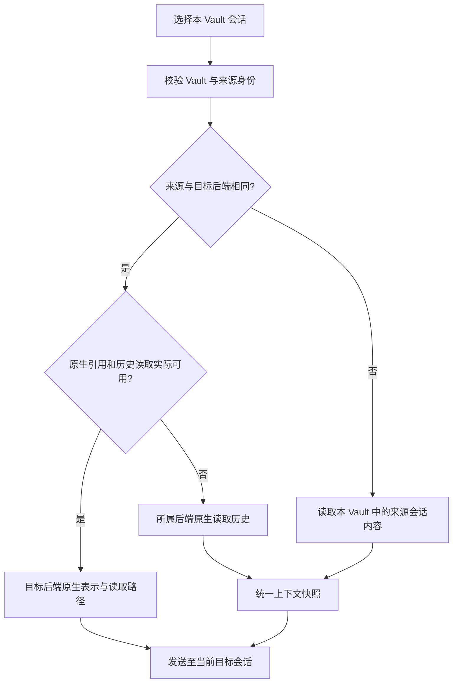

# 六后端 @ 能力与 Vault 内跨后端会话引用调研

日期：2026-10-29（Asia/Shanghai）。状态：源码／官方文档调查完成，统一入口与引用链路已实施；下文保留调研证据，实际落地范围见文末。

## 结论与用户确认的范围

可以统一前端 `@` 入口，并让六个后端互相引用会话内容。用户已明确项目范围为**当前插件工作目录／Obsidian Vault**，无需进一步按 Vault 内的 Git 子仓库切分。

建议统一的是候选、选择标签和历史上下文的读取入口，原生会话身份继续由所属后端管理。读取本后端会话时优先使用实际可用的原生引用；跨后端则准备统一的上下文快照。原生引用不可用时，可通过所属后端的原生历史读取接口准备同一种快照。不能把“原生没有这种引用语义”描述为原生引用成功。

插件类候选按当前运行时的**可引用能力**显示。具有扩展／插件加载器，并不自动意味着具有 `@插件` 的目录与调用协议。

本报告区分四种行为：

1. 引用历史：把另一个会话的既有内容提供给当前回合。
2. 原生会话指针：给模型会话身份，再由原生读取工具按需读取。
3. 恢复／分叉：继续原会话或创建分支。
4. 跨会话消息：向另一个运行中的会话发消息。

用户本次要求对应前两种。后两种不能用来替代历史读取。

## 版本与证据基线

调查时在线查询了以下官方仓库 HEAD，代码链接固定到对应 SHA。OpenCode、Pi 的本地相关文件与其已核对提交无差异；ZCode 的关键面板、目录和序列化代码另从公共提交直接下载复核。未修改外部源码仓库。

| 后端 | 本机可见运行时／SDK | 本轮上游源码基线 |
| --- | --- | --- |
| OpenCode 2 | CLI 2.2.0；`@opencode/client` 2.2.0 | `anomalyco/opencode@510aa79d075c32e75f85b7774ff7390370c22b18` |
| Claude Code | CLI 2.1.312；Agent SDK 0.3.312 | 官方在线文档；CLI／桌面实现不按开源源码推断 |
| Codex | CLI 0.165.0；SDK 0.165.0 | `openai/codex@23934d31b15b1127c83535f84854e5009f7cd51d`；桌面能力另查官方文档 |
| Pi | PATH 下 CLI 1.4.0，包名 `@earendil-works/pi-coding-agent` | `earendil-works/pi@e65b3b88c08412bb8ffbd21fb5dc5756064a6e5a` |
| ZCode | 已检查本地源码包 3.16.1；本轮未重新核验插件当前配置的启动入口 | 公共 HEAD `zai-org/ZCode@3c5b227649371507ddc4eb46ac5133afe6db1cab` |
| DSH | CLI 0.2.1-rc.4 | 公共 HEAD `deepseek-ai/deepseek-harness@f3803c96974ad4a94195fb97e5c637e9c2a3afe3`，提交标记 0.2.2-alpha.2 |

上游代码存在某个能力，不等于当前插件使用的运行时已经暴露该能力。尤其 DSH 的服务挂载、Codex 的宿主工具、Claude 的账号／运行模式都需要后续运行时探测。遗留 `@opencode-ai/sdk` 1.x 不用来解释 OpenCode 2 的行为。

## 六后端原生 @ 能力矩阵

| 后端／界面 | 文件与文件夹 | 会话／对话 | 插件与其它候选 |
| --- | --- | --- | --- |
| OpenCode 2 TUI | 文件、目录、文件行范围 | 本轮核对的 TUI 候选聚合没有会话分组 | 子代理、技能、配置的 reference 别名（本地或 Git 参考目录）；不是通用 `@插件` 清单 |
| OpenCode 2 桌面／Web | 文件、目录、已打开文件等上下文 | 有会话候选；显示标题，发送时转为稳定 `@session:ses_…` | 子代理、技能、reference 别名；未发现通用插件包引用分组 |
| Claude Code CLI | 官方明确文件路径补全；目录的具体展开行为本轮未独立运行验收 | `@会话名` 可选择其它活跃会话，语义是定向消息，不是历史自动注入 | 子代理、插件提供的具名子代理、MCP resources；不能等同于 `@插件包` |
| Claude Code 桌面 | 官方明确文件 @mention；另有文件附件入口 | 文档有多会话／跨会话操作，但未证明与本次“读取历史”相同的 @历史入口 | 桌面有插件管理；本轮未找到统一 `@插件包` 目录的明确文档 |
| Codex 开源 TUI | File、Directory | Task 候选对应既有 chat/thread | Plugin、Skill；另有结构化 app／plugin mention 协议 |
| Codex 桌面 | 官方说明项目／文件上下文；本轮未逐项运行验收桌面文件夹补全 | 本轮未取得桌面 @历史会话的完整官方规格；CLI Task 另有源码证据，官方移动端跨宿主 @chat 更新不作为桌面等价证明 | 官方确认 @插件／技能、浏览器／标签页等宿主能力；这些不能靠只连接 CLI 自动获得 |
| Pi 核心 TUI | `@path`、带空格路径、目录补全／继续下钻 | 未发现核心 @历史会话候选；会话管理是另一条能力 | 有 extensions／packages，但核心补全未提供通用 @插件分组；第三方自定义补全不算核心默认支持 |
| ZCode 桌面／Web | 文件、目录 | 当前公共源码 `@` 已包含当前 workspace 会话；`#` 仍为会话专用入口 | `@` 还包含已启用 Plugin 和白板；`$` 是技能入口。子代理有独立的 mention 语法，不能只因类型定义存在就视为当前 @面板分组 |
| DSH 官方 ui-reference | 文件、目录；支持直接选择目录与继续下钻两种动作 | 普通 @查询合并文件和会话（包含子会话）；显式 quoted 路径查询只列文件 | 默认 reference source 没有通用 @插件包分组。Cordis 插件可扩展客户端 source，但需要实际挂载及协议 |

“未发现”仅针对列出的核心源码／官方文档范围，不是宣称所有第三方扩展都不可能做到。

## 原生会话引用到底如何执行

### OpenCode 2

桌面 `model.ts` 通过 `session.list`／`session.get` 构造会话候选；`prompt-parts.ts` 把显示标题替换为稳定的 `@session:ses_…`；`request.ts` 将其纳入提交文本。当前 `PromptInput` schema 有 `text/files/agents/skills`，没有独立的会话附件字段。

因此已经证实的是**原生桌面候选与稳定文本引用**，而非已证实自动把完整历史注入当前模型。本轮未沿实际模型回合验证该文本引用如何读取历史。OpenCodian 可以先用自己的 `OpenCode2Adapter.getSessionMessages()` 读取原生历史形成统一快照，原生指针模式要另做读取证据验收。

证据：

- [TUI 候选聚合与文件／代理／技能／reference](https://github.com/anomalyco/opencode/blob/510aa79d075c32e75f85b7774ff7390370c22b18/packages/tui/src/component/prompt/autocomplete.tsx#L323-L459)
- [桌面会话候选](https://github.com/anomalyco/opencode/blob/510aa79d075c32e75f85b7774ff7390370c22b18/packages/app/src/composer/model.ts#L370-L420)
- [稳定会话引用序列化](https://github.com/anomalyco/opencode/blob/510aa79d075c32e75f85b7774ff7390370c22b18/packages/app/src/composer/prompt-parts.ts#L4-L24)
- [提交文本的生成](https://github.com/anomalyco/opencode/blob/510aa79d075c32e75f85b7774ff7390370c22b18/packages/app/src/composer/request.ts#L115-L140)
- [原生输入 schema](https://github.com/anomalyco/opencode/blob/510aa79d075c32e75f85b7774ff7390370c22b18/packages/schema/src/prompt-input.ts#L23-L28)

### Claude Code

官方文档明确，`@` typeahead 可发现子代理、插件的 scoped 子代理、MCP resources，以及其它活跃会话。会话 mention 自 2.1.232 起有文档；跨会话消息功能还受到 provider 和运行模式限制。

关键差异：发送到另一会话的是消息文本，官方明确不会把发送者的完整历史或文件一起转移。因此不能用 `@api-worker` 来实现本次“参考以前那次讨论”。本后端历史仍可经 Agent SDK 的 `getSessionMessages` 原生读取，再准备统一快照。

插件能力应具体展示为“子代理”“MCP 资源”等已可调用类型；不能列出一个插件包后假定原生支持把整个插件作为 mention 调用。MCP resource 与 MCP tool 也不是同一种对象。桌面文档还明确了文件 mention 的界面／云端首回合差异。

证据：

- [CLI 的 @ 与活跃会话补全](https://code.claude.com/docs/en/interactive-mode#quick-commands)
- [跨会话消息的语义与限制](https://code.claude.com/docs/en/cross-session-messaging)
- [子代理及插件子代理的显式引用](https://code.claude.com/docs/en/sub-agents#invoke-subagents-explicitly)
- [MCP resources 的 @ 引用及附件语义](https://code.claude.com/docs/en/mcp#reference-mcp-resources)
- [闭源桌面客户端的文件上下文说明](https://code.claude.com/docs/en/desktop#add-files-and-context-to-prompts)

### Codex

开源 TUI 当前枚举的 mention 类型包含 Plugin、Skill、Task、File、Directory。Task 选择绑定 thread 身份，`task_mentions.rs` 在提交时增加读取指引，要求用 `read_thread` 读取相关会话，标题与内容作为不受信任背景；它不是直接把全部历史复制进 prompt。

App Server 有 `thread/read`、分页历史读取，以及 `UserInput::Mention {name,path}`。app/plugin 引用具有明确的 `app://…`／`plugin://…` 身份。**Task TUI 的处理在宿主层，不能假定给 turn/start 填一个任意 mention 就等价于原生 read_thread 工具已安装。** OpenCodian 必须核实原生读取工具可用，或通过原生 thread 读取接口准备快照。

闭源桌面端另外查了官方 Plugins、浏览器扩展、更新记录。官方 2026-10-22 移动端更新明确记载从其它已连接宿主 @chat，说明官方产品的发现范围可能大于一个本地项目；OpenCodian 应应用自己的 Vault 过滤，不能照搬宿主范围。开源 CLI 枚举与某个桌面版本的菜单内容分别记录，不用其中一方证明另一方完全一致。

证据：

- [当前 TUI 的 mention 类型](https://github.com/openai/codex/blob/23934d31b15b1127c83535f84854e5009f7cd51d/codex-rs/tui/src/bottom_pane/mentions_v2/candidate.rs#L18-L25)
- [Task 引用及 read_thread 指引](https://github.com/openai/codex/blob/23934d31b15b1127c83535f84854e5009f7cd51d/codex-rs/tui/src/task_mentions.rs#L226-L283)
- [原生输入的结构化 Mention](https://github.com/openai/codex/blob/23934d31b15b1127c83535f84854e5009f7cd51d/codex-rs/protocol/src/user_input.rs#L48-L57)
- [App Server：threads、apps 与输入协议](https://learn.chatgpt.com/docs/app-server)
- [官方插件显式 @ 入口](https://learn.chatgpt.com/docs/plugins)
- [官方浏览器／标签页 @ 入口](https://learn.chatgpt.com/docs/chrome-extension)
- [官方更新记录](https://learn.chatgpt.com/docs/changelog?date=2026-10-22)

### Pi

核心 `CombinedAutocompleteProvider` 实现文件／目录补全、@前缀和引号路径，目录选择保持继续补全所需的光标状态。核心可以加载 extensions、skills、prompt templates、packages，但本轮检查的核心 @补全没有历史会话或插件包类型。

因此 Pi 的历史引用应通过原生会话读取接口取源，再由统一层附加；不应把一个陌生会话的 ID 当作 Pi 原生命令。扩展可新增自己的补全，只能在检测到并接通它的协议后作为扩展能力展示。

证据：

- [核心 autocomplete 中的 @路径和目录选择](https://github.com/earendil-works/pi/blob/e65b3b88c08412bb8ffbd21fb5dc5756064a6e5a/packages/tui/src/autocomplete.ts#L422-L466)
- [官方扩展类型说明](https://github.com/earendil-works/pi/blob/e65b3b88c08412bb8ffbd21fb5dc5756064a6e5a/packages/coding-agent/README.md)

### ZCode

当前公共源码的 `getMentionPanelGroupOrder('@')` 明确返回 plugins、files、sessions、whiteboards。`@` 会话 provider 限 current workspace，而 `#` 入口允许 same-authority-workspaces，二者的发现范围不同。

在输入框从 `@` 选择会话后，canonical 序列化仍是 `#sess_…` 或标题指向该 ID 的 Markdown。CLI 识别该 ID 并增加提醒；历史不会自动展开，模型按需调用 `ReadSessionContext`。插件使用 `plugin://stable-id`，目录只包含 enabled 的插件，同名冲突有禁选处理。

因此 ZCode 的前端 `@` 完全可以统一，但给它发送时必须转换成其真实的 session／plugin canonical 表示。

证据：

- [公开源码中的 @分组与 workspace 范围](https://github.com/zai-org/ZCode/blob/3c5b227649371507ddc4eb46ac5133afe6db1cab/packages/ui/src/mentions/mentionPanelRouting.ts#L3-L42)
- [会话候选的来源和范围过滤](https://github.com/zai-org/ZCode/blob/3c5b227649371507ddc4eb46ac5133afe6db1cab/packages/ui/src/mentions/providers/sessionsMentionProvider.ts#L93-L197)
- [会话和插件的 canonical 序列化](https://github.com/zai-org/ZCode/blob/3c5b227649371507ddc4eb46ac5133afe6db1cab/packages/ui/src/mentions/mentionMarkdown.ts#L82-L94)
- [按需读取历史的原生提醒](https://github.com/zai-org/ZCode/blob/3c5b227649371507ddc4eb46ac5133afe6db1cab/apps/zcode-cli/packages/core/src/session-context/references.ts#L13-L25)
- [已启用插件的目录与冲突处理](https://github.com/zai-org/ZCode/blob/3c5b227649371507ddc4eb46ac5133afe6db1cab/packages/ui/src/mentions/providers/pluginsMentionProvider.ts#L22-L99)

### DSH

官方 ui-reference 把文件和 session resolver 合并到一个 @source。文件／目录是路径引用；会话选择得到 `@[label](dsh-session:<base64url-id>)`。`dsh-session-reference` 在原生 pre-step 准备只读历史快照，并把它作为带来源的背景上下文持久化到目标会话。

默认最多引用 3 个不同会话，预览有字节／模型上下文预算。快照包含直接用户文本、助手文本与明确压缩检查点，排除工具、推理和其它注入上下文，避免引用递归扩张。发现接口优先同目录排序，但不是严格只返回同目录；OpenCodian 必须额外过滤其它 Vault。

DSH 的服务是可选挂载；OpenCodian 现有 native bridge 没有因为上游默认 Web UI 有它，就自动获得候选 RPC。ACP 模式也不能直接假定具备 native 模式的引用能力。

证据：

- [官方 @ UI 与文件／会话候选](https://github.com/deepseek-ai/deepseek-harness/blob/f3803c96974ad4a94195fb97e5c637e9c2a3afe3/packages/client/ui-reference/README.md#L25-L60)
- [文件／目录引用协议](https://github.com/deepseek-ai/deepseek-harness/blob/f3803c96974ad4a94195fb97e5c637e9c2a3afe3/packages/context/file-reference/README.md#L25-L40)
- [会话快照、预算与候选范围](https://github.com/deepseek-ai/deepseek-harness/blob/f3803c96974ad4a94195fb97e5c637e9c2a3afe3/packages/context/session-reference/README.md#L28-L89)

## OpenCodian 当前实现与可复用接口

本地基线提交为 `73bb30adf`。

- `src/features/chat/services/composer/AgentMentionComposerController.ts`：目前 @主要由 agent mention 控制器处理；不是统一资源／会话／插件目录。
- `src/features/chat/services/composer/ComposerInvocationEditor.ts`：已有 atomic token 和图标／文字渲染，可用于统一选中后的视觉与编辑体验。
- `src/core/types/chat.ts`：`PromptContextKind` 有 file、folder、selection、PDF、URL 等，尚无 session reference；`Conversation` 和 `ConversationMeta` 保留 backend 与 backendSessionId，没有独立的会话 Vault 身份字段。
- `src/core/agents/backend/AgentService.ts`：六后端已具备可复用的 session/history 接口形状，原始消息仍需按来源后端归一化。
- `src/core/agents/backend/AgentBackendRouting.ts`：已有 `getBackendSessionPreview`、详情和分页能力。引用不能直接把“预览有数据”当作“全文读取完整”。
- `src/features/chat/ui/BackendSessionBrowserModal.ts`：已有用 scoped registry 读取指定后端的办法，不需要临时改变全局 active backend。
- `src/core/storage/StorageService.ts`：当前 Vault 内的插件会话文件／元数据，可成为统一目录的可信起点。
- `src/core/agents/backend/AgentAdapterWiring.ts`：多数 adapter 的 workingDirectory 由 vaultPath 注入；具体 native session 仍要核对真实 cwd／工作区归属。

### 已有六种原生历史读取路径

| 来源后端 | 现有拥有者接口 | 统一层需要注意 |
| --- | --- | --- |
| OpenCode 2 | `OpenCode2Adapter.getSessionMessages` | 分页、原始 parts 与上下文完整性 |
| Claude Code | `ClaudeCodeAdapter.getSessionMessages` → Agent SDK | SDK 的 dir、offset、limit；不把活跃消息接口用作读取历史 |
| Codex | `CodexAdapter.getSessionMessages/getSessionTurnsPage` | thread 身份和分页终点；native Task 指针需宿主读工具 |
| Pi | `PiAdapter.getSessionMessages` → session RPC `get_messages` | 树状会话应使用当前有效分支；不把所有分支拼接成一个历史 |
| ZCode | `ZCodeAdapter.getSessionMessages` | 对应 native session／task 身份；专门的 ReadSessionContext 另做能力探测 |
| DSH | `DshAdapter.getSessionMessages` | native／ACP 区别、session-query／resolver 挂载情况 |

以上是代码存在性证据。本轮未新建模型回合去验收六种引用执行，不把已有普通历史浏览测试当作引用功能验收。

## 建议统一设计

### 候选和身份

一个 @面板分成“文件与文件夹”“本 Vault 会话”和当前后端支持的其它分组，例如“插件”“子代理”“MCP 资源”。不支持的分组直接不出现。继续保留 `/` 与 `$` 的现有行为，避免此次统一反过来破坏已交付入口。

会话候选显示：标题、来源后端、更新时间。标题只用于显示，选择后保存结构化身份，至少包括：

```ts
type SessionReferenceIdentity = {
  vaultKey: string;
  sourceBackend: AgentBackendKind;
  backendSessionId: string;
  conversationId?: string;
  displayTitle: string;
};
```

`vaultKey` 表示本插件 Vault 的规范身份；本机比较使用规范化真实路径，跨机器别名复用已有 workspace identity／alias 机制时要先核对等价性。身份键包含后端与会话 ID，不通过标题、provider 名或相同 ID 字符串猜归属。

目录先使用当前 Vault 的插件会话；可补充当前 Vault 下通过原生目录发现的会话，但必须有可验证的 cwd／workspace 归属。不加载用户全局所有项目后直接在前端显示。未知归属的原生条目不自动归到本 Vault。读取和发送前再校验一次，避免已选择对象在切换 Vault 或异步目录刷新后串用。

### 发送决策



同后端的“原生”分成两层：有原生引用协议时用原生指针／resolver；只有原生历史读取接口时，通过它读取，再用统一快照。这样 Claude、Pi 也能实现用户需要的历史引用，而不虚构上游没有的 @history。

跨后端读取必须明确 sourceBackend，再通过来源拥有者或已有可信本地历史得到内容。最终只向当前目标 backend 发送，不能把来源会话 ID交给目标 backend 作为恢复 ID，也不应临时切换全局 active backend。

原生引用路径还必须满足本 Vault 范围约束。若原生宿主无法确认或约束来源归属，则先由插件完成归属校验和原生历史读取，再走快照路径；仅按同目录“排序”不符合本需求。

### 统一快照

快照保留来源后端、会话 ID、标题、Vault 身份、捕获时间、消息／回合范围、完整或截断状态。正文提取直接用户与助手可见文本，必要时保留明确的压缩摘要和引用文件路径；不回放工具调用、不携带权限答复、不把来源会话里的引用再次递归展开。

发送前按目标模型的上下文预算准备，截断时保留遗漏事实；需要继续读取时由只读、Vault 受限的历史读取接口分页补充。记录此次实际注入的快照，保证重载／重试时可解释其内容；动态原生指针则明确记录其采用原生读取策略，不能与固定快照混为一谈。

这些历史内容是背景材料，不是当前用户的新指令。引用不会触发来源会话运行、发消息、恢复或分叉。原生读取是否会启动辅助进程、是否会更新源记录，需要在各 adapter 的运行验收中单独检查。

### 插件分组的显示规则

以运行时返回的“可引用目录 + 明确的序列化方式”作为显示条件，而非按后端名称永久写死。

| 当前可证明的能力 | 建议展示 |
| --- | --- |
| Codex 的有效 plugin／app 目录、可用 Mention 输入协议 | 插件／应用；过滤未启用、不可调用或策略禁止项 |
| ZCode enabled plugin reference catalog | 插件；保留稳定 pluginId，正确处理同名冲突 |
| Claude 插件提供的子代理／MCP resources | 对应的子代理／资源分组；没有独立 plugin mention 证据时不显示泛化的“插件包”候选 |
| OpenCode／Pi／DSH 仅有插件加载器，没有已接通的 @插件目录 | 隐藏插件分组；其技能／代理／资源按各自实际能力出现 |

不跨后端复制插件目录。切换 backend 时使旧目录与未完成请求失效，发送前重新验证选中条目；不能让 ZCode 插件 token 在 Pi 下被当作已经支持的插件调用。

## 实施与验收建议

优先扩展现有 composer、context preparation 和 backend routing 拥有者。统一的候选与准备接口隐藏六后端差异，避免在 `OpenCodianView` 中堆叠新的运行时分支。

建议实施顺序：统一 @候选与 token 身份 → Vault 会话目录 → 统一历史快照 → 已证实的原生引用 → 插件／MCP／子代理能力分组。各阶段须保持本后端源目录隔离。

最低验收场景：

1. 六后端 × 六来源后端共 36 种会话引用组合；分别证明选中的 ID、读取来源及最终目标，不只看标签出现。
2. 同标题、同字符串 ID、两个不同 Vault 的会话不混淆；目录和发送均排除其它 Vault。
3. 本后端原生引用可用／缺失两条路径；Claude 的活跃会话消息不作为历史读取替代品。
4. 选中后切 backend、切会话、目录失效、来源删除、后端离线时得到真实结果；可使用的本地快照明确记录捕获时间与完整性。
5. 长历史分页、有效分支、压缩检查点、截断范围与再读取；目标上下文预算超限不静默丢内容。
6. 文本金额／邮件中的 @不误识别；中文、空格路径、长标题、复制粘贴、撤销、IME、光标与原子删除保持一致。
7. 插件不支持、未启用、不可调用、同名冲突、切后端后失效；UI 可见性与发送协议同时验证。
8. 重载后仍可还原此次引用的身份、来源和实际快照；来源历史中的工具／权限信息不会被重放。

## 实际落地范围（2026-10-29）

统一 `@` 菜单与原子标签已接入文件、文件夹、本 Vault 插件会话和运行时可用原生插件。稳定身份与实际会话快照存入目的消息，原生历史同步保留可读名称与引用证据。文件在发送前验证 realpath，拒绝越界链接；会话只读取当前 Vault 已保存的插件会话目录与身份。

同后端优先调用已验证的原生引用：DSH bridge 仅在 resolver 挂载且来源、目的会话归属通过时启用。其它情况经来源后端读取生成统一快照；Codex 使用显式 thread/read，ZCode/Pi 只读已驻留来源，不启动或恢复来源会话。缺少可用原生读取时，回退到明确标记 `plugin-cache` 的完整插件持久化历史。原生 ZCode `#` 指针未被当前协议证明，因此未启用。快照总正文默认限制 48,000 字符，可配置到最多 120,000，并保存省略／截断信息；此处不宣称已实现目标模型 token 预算的动态分页续读。

原生插件候选已接通 Codex 的已安装、启用、策略允许目录，以及 ZCode 已启用且无同名冲突的插件目录；发送前再次验证。通用 app、MCP resource 目录尚未接通，未支持的后端不会显示伪造插件候选；原有真实子代理入口保留。`/` 和 `$` 沿用已交付行为。

核心服务测试覆盖 36 种来源／目的后端组合；这属于隔离服务验证，不能替代 36 次真实模型运行。构建、完整检查和 Test Vault 运行证据在本轮工作区 `.obsidian-debug/at-*` 中分别记录。
